# worldhood

<a href="https://worldhood.org">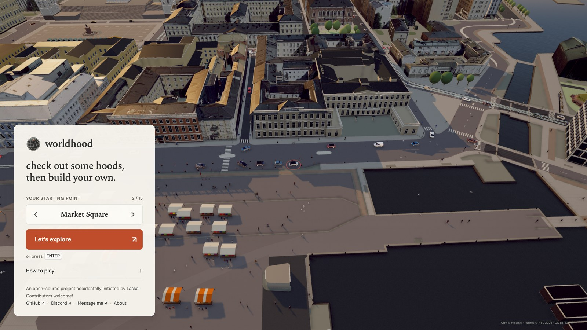</a>

**check out some hoods, then build your own.**

**[Play at worldhood.org](https://worldhood.org)** · **[▶ Watch the tour](https://worldhood.org/media/worldhood-tour.mp4)** (30 s video)

There have been city games before. But for the first time, anyone can recreate the world, street by street.

An open-source city playground in your browser. Explore Helsinki and Tampere by car, on foot,
by bicycle or on an e-scooter. Greet people, try another car, or help recreate a place you know.
The streets and buildings come from open map and city data, with local details added by contributors.

<p align="center"><a href="https://worldhood.org/media/worldhood-tour.mp4">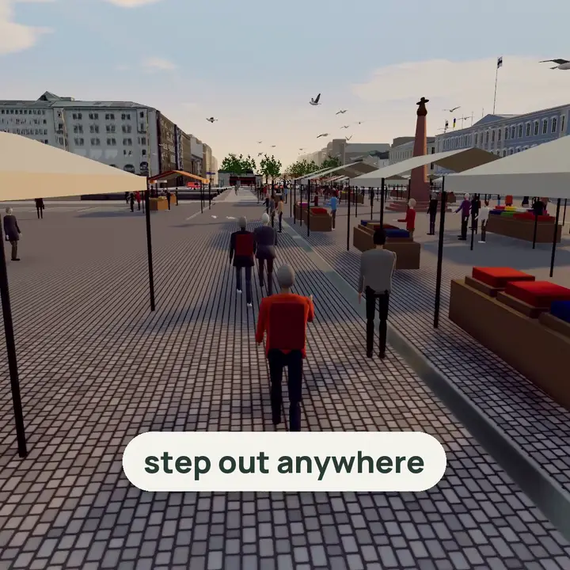</a></p>

The current game is single-player. A shared online world and player-owned territories are future
plans. Adding and improving cities currently happens through this repository, rather than an in-game editor.

The game runs entirely in the browser (three.js + Vite), with no account, backend or API key needed
to play. Optional contributor tools that fetch data or process reference photos may require their
own API keys; see `.env.example` and the city-building guide.

## Two ways to help

**🏙️ Build your city, properly.** Bring a place you know into the game. The bar is high: a city
goes live on worldhood.org only when someone who lives there recognises every street. Real
buildings, trees, trams, signs and paving, checked against photos. Drafts are welcome while you
work. No coding needed: start with the [plain-language guide](docs/START_HERE.md).

**🎮 Shape the gameplay.** What should you actually *do* in worldhood? Prototype activities,
vehicles, people, missions, weather and sound. Play it, keep what's fun. Anything good works in
every city. Start from the [wishlist](docs/IDEAS.md) and the [engine code map](docs/GAMEPLAY.md).

How we work: [vision](docs/VISION.md) · [CONTRIBUTING.md](CONTRIBUTING.md) · [GOVERNANCE.md](GOVERNANCE.md) · [Discord](https://discord.gg/c6SaPvxhJG)

Originally built by [Lasse](https://www.linkedin.com/in/lassesaari/). Have an idea? [Tell me](https://www.linkedin.com/in/lassesaari/).

## A look around

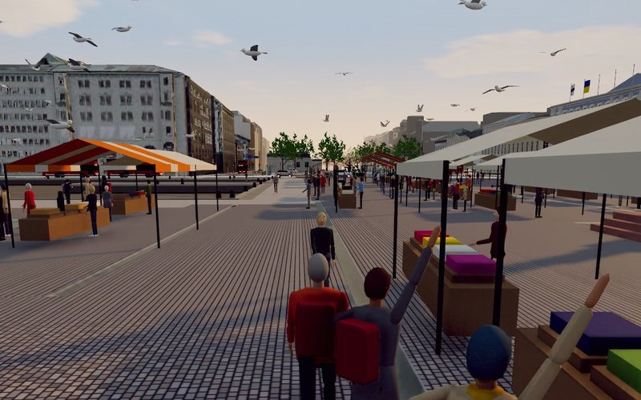 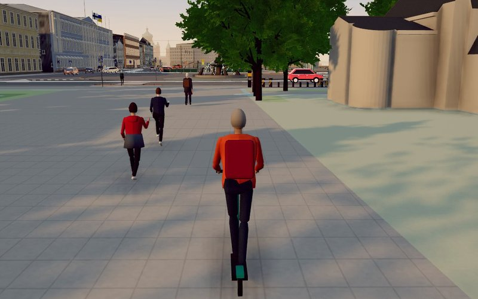
<br><sub><b>Kauppatori, Helsinki:</b> the market stalls and their gulls · <b>Esplanadi:</b> walk, run, or grab a scooter or city bike</sub>

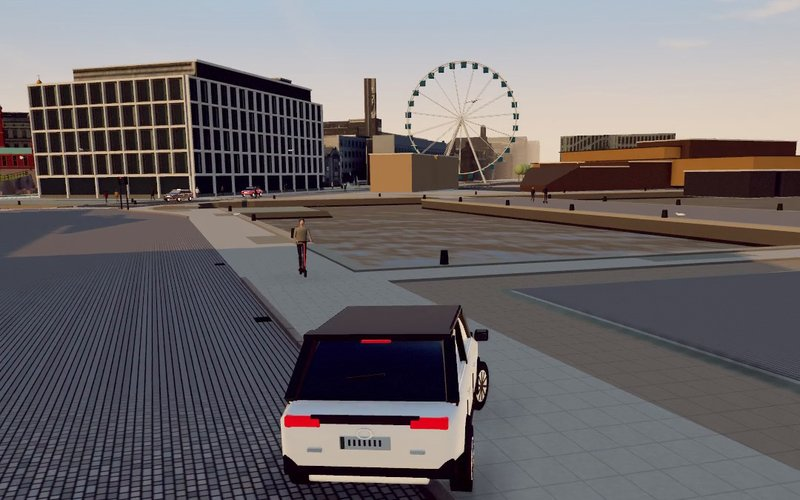 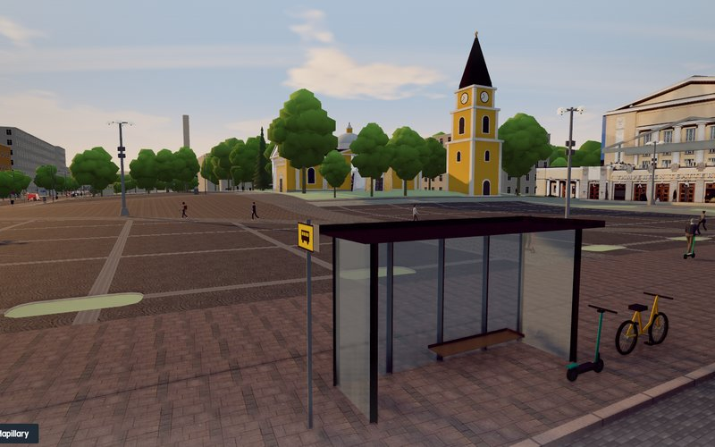
<br><sub><b>South Harbour, Helsinki:</b> drive the waterfront · <b>Keskustori, Tampere:</b> the central square</sub>

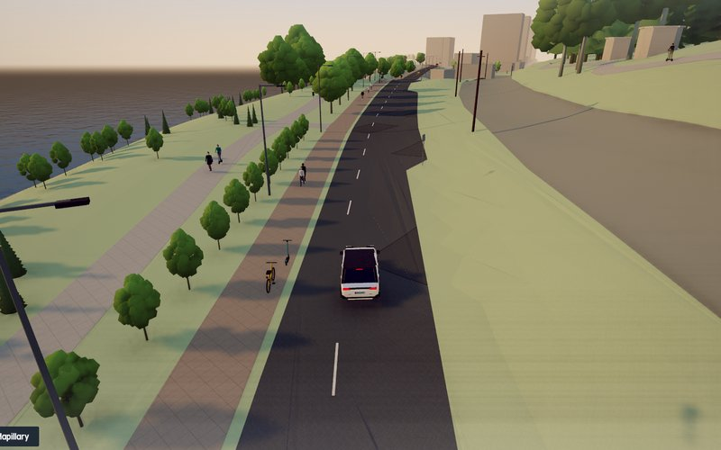  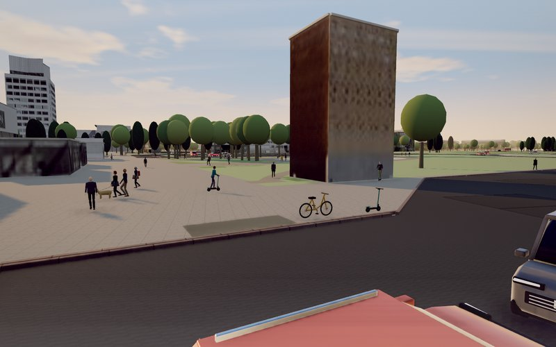
<br><sub><b>Tampere:</b> real terrain, from the lakeshore up the hills · <b>Tapiola, Espoo:</b> drive on from Helsinki into Espoo</sub>

### Weather and time of day

Press **T** to change the light. The same street in Helsinki, Esplanadi:

<table>
<tr>
<td align="center">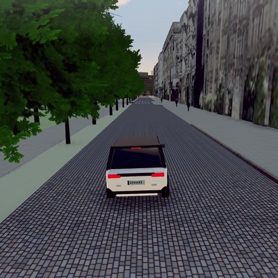<br><sub>Golden evening</sub></td>
<td align="center">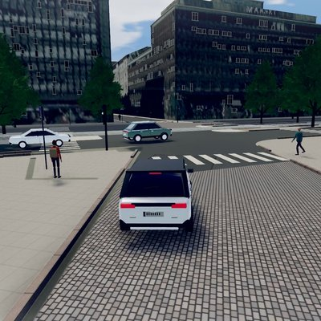<br><sub>Midday</sub></td>
<td align="center">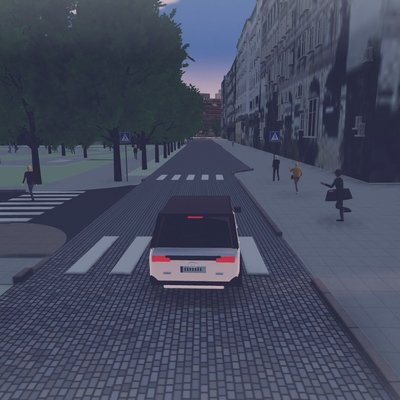<br><sub>White night</sub></td>
<td align="center">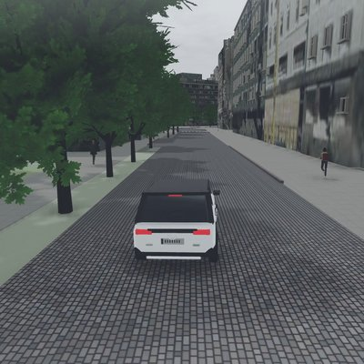<br><sub>Overcast</sub></td>
<td align="center">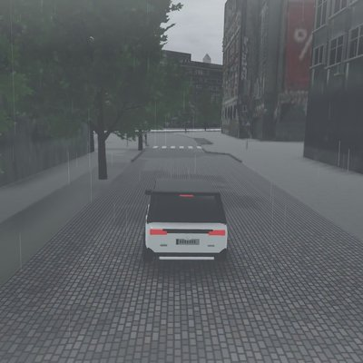<br><sub>Rain</sub></td>
</tr>
</table>

## Run

```sh
npm ci
npm run dev
```

Use Node.js 22 or newer. Open the URL Vite prints in a modern browser with WebGL2.

| Key | Action |
| --- | --- |
| W / S or ↑ / ↓ | Accelerate / brake and reverse |
| A / D or ← / → | Steer |
| Space | Brake (car, bicycle or scooter) |
| F | Get out of the car / get off a ride |
| Enter | Enter a nearby stopped car / mount a bicycle or scooter |
| Shift (hold) | Run while on foot |
| G | Talk to a nearby person or market seller / end a conversation |
| E (near a stall) | Open its menu, or use the item in your hand |
| R | Back to your starting point |
| M | City map and starting points |
| C | Drive / Follow / High camera |
| Q / E (hold) | Look left / right |
| T | Time of day / weather |
| H | Hide the HUD |
| V | Capture mode (full resolution, no camera shake) |

On a phone, slide the steering control and hold **Go**; **Brake** slows down, then reverses.
**Menu** contains the map, camera, weather, sound and steering choices. Small context buttons
let you get out, run, use a nearby ride or greet someone.

Conversations offer follow-up choices and remember the current visit. At market stalls, ask the
seller about their goods or open the menu. Enable sound for installed browser voices; captions
work even when a voice is unavailable. These are fictional game characters with authored dialogue.

```sh
npm test          # unit tests
npm run build     # static build in dist/, deployable to any static host
```

## Cities

<!-- CITIES:START -->
| | City | Play | Status | Data | Maintainers |
| --- | --- | --- | --- | --- | --- |
| <a href="https://worldhood.org/?city=helsinki">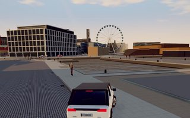</a> | Helsinki, Finland | [`?city=helsinki`](https://worldhood.org/?city=helsinki) | playable | City of Helsinki 3D city model + open data, HSL | wanted |
| <a href="https://worldhood.org/?city=tampere">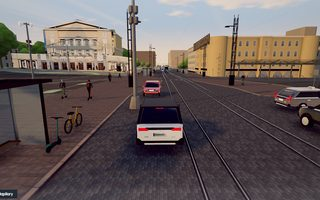</a> | Tampere, Finland | [`?city=tampere`](https://worldhood.org/?city=tampere) | draft | OpenStreetMap | wanted |
| <a href="https://worldhood.org/?city=oulu">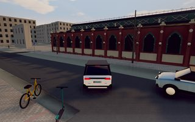</a> | Oulu, Finland | [`?city=oulu`](https://worldhood.org/?city=oulu) | draft · [help wanted → #68](https://github.com/worldhood/worldhood/issues/68) | OpenStreetMap | zaw-ye-tun |
<!-- CITIES:END -->

Running it locally? Use `http://localhost:5173/?city=<id>`.

## Improve the game engine

Movement, vehicle entry, conversations, police, cameras and touch controls are shared across cities.
Work on rendering and streaming helps every place load and play better. Start with the
[engine code map](docs/GAMEPLAY.md), choose a small improvement, and include a reproducible
example or a test for the behaviour you change. You do not need to build a city to contribute.

## Build your own city

**Not a programmer?** Start with **[docs/START_HERE.md](docs/START_HERE.md)**: a plain-language,
step-by-step guide. Local knowledge, properly licensed reference material and testing all help.
You can work with another contributor or a coding agent; AI tools are optional.

Any city works, starting from just its name:

```sh
npm run city:new   -- tampere "Tampere, Finland" 1500   # find it, set the playable radius (m)
npm run city:build -- tampere                            # OpenStreetMap → game data
npm run dev                                              # then open /?city=tampere
```

You get:
- 3D buildings at their mapped heights
- streets with real surfaces (cobblestones rumble)
- water, parks and trees
- a routable traffic network with traffic lights, used by traffic and pedestrians
- tram and bus lines with stops, from OpenStreetMap routes
- start points at the city's best-known places

A fresh build is only a starting point. Refine a small area street by street using permitted
reference material: buildings, trees, signs, surfaces, local buses and trams. Drafts can be
reviewed with their gaps documented; recognisable, carefully checked streets are the aim. The step-by-step **[playbook](docs/BUILD_YOUR_CITY.md)** ends with
a ready-made **agent prompt** you can paste into your own coding agent so it builds your city for
you.

### Add your city to the game

1. **Fork** this repository and create a branch, e.g. `city/tampere`.
2. **Build:**
   - `npm run city:new -- <id> "<City, Country>"`, then `npm run city:build -- <id>`.
   - The build also adds your city to the table above, via `npm run cities:readme`.
3. **Make it yours:**
   - Put your GitHub handle in `maintainers` in `cities/<id>/city.json`.
   - Optionally add a screenshot as `docs/media/cities/<id>.jpg` (about 320×200 JPEG) for the table above.
   - Add these lines to `.github/CODEOWNERS`:
     ```
     /cities/<id>/          @you
     /public/cities/<id>/   @you
     ```
4. **Check:** run `npm test` and `npm run build`. Then drive every start point at
   `/?city=<id>` with no console errors.
5. **Open a pull request** titled `City: <name>`. The template asks for:
   - 3–5 screenshots;
   - the `?city=<id>&start=<place>` links;
   - your data sources.

   Commit `cities/<id>/`, `public/cities/<id>/`, `public/cities/index.json` and the README change.
   Never commit `data/raw/` or `.env.local`.
6. **Review:**
   - An automated check runs the tests and build.
   - A maintainer drives it and merges it as `draft`.
   - It moves to `reviewed` once the [playbook](docs/BUILD_YOUR_CITY.md) stage 3–4 checks pass and
     a local confirms.

Building the data yourself is optional: you can open an **Area claim** / city issue and ask
someone to help.

## The map

- The core area is a 2 km circle around Helsinki Cathedral.
- **Extensions** add more areas: the Mannerheimintie → Töölö → Seurasaari corridor, Länsiväylä over
  Lauttasaari and Koivusaari, and on into Espoo (Keilaniemi, Otaniemi, Tapiola) on Espoo's own open 3D city model.
- **Pick a city and start point** in the URL: `?city=helsinki&start=seurasaari-bridge` or
  `?city=tampere`.
- Coordinates are local metres (X east, Z south) from each city’s configured origin. Helsinki uses 24.9522 E, 60.1701 N and the municipal
  ETRS-GK25 projection (EPSG:3879).

The game is not a survey-exact digital twin:
- Terrain depends on the city: Tampere uses bundled elevation data; Helsinki and the Espoo extension currently use flattened ground.
- Some façades and landmark details are approximations.
- Traffic, pedestrians and police are simulated.

## Rebuilding data

Runtime data is bundled in `public/data` and `public/cities/<id>`; optional regions and distant scenery load as needed. To refresh it from the public sources:

```sh
npm run data:fetch && npm run data:build
npm run data:textured
npm run data:mobility
```

## Contributing

This is a community project, and contributions of every size are welcome.

- **Start here:** [CONTRIBUTING.md](CONTRIBUTING.md) explains your first pull request step by step.
- **Pick a task:**
  - the [wishlist](docs/IDEAS.md), where every idea is an open issue: changing weather, sound,
    seagulls, things to do on foot, changing cars, driving trams;
  - [`good first issue`](https://github.com/worldhood/worldhood/issues?q=is%3Aissue+is%3Aopen+label%3A%22good+first+issue%22)
    for small starters;
  - or build your city.
- **Show it:** pull requests that change the game include a screenshot or a short gameplay
  video (before/after if you can); drag and drop it into the description. Docs-only changes
  don't need one. See [Show your change](CONTRIBUTING.md#show-your-change).
- **Talk:** [Discord](https://discord.gg/c6SaPvxhJG) for live chat and sharing drives, and
  [Discussions](https://github.com/worldhood/worldhood/discussions) for questions and ideas that should stay searchable.

Guides:
- [docs/RECOGNISABILITY.md](docs/RECOGNISABILITY.md): what makes a city recognisable, learned from Helsinki.
- [docs/BUILD_YOUR_CITY.md](docs/BUILD_YOUR_CITY.md): the playbook and agent prompt for a new city.
- [docs/EXTENDING.md](docs/EXTENDING.md): build and review a new area, and use OpenStreetMap and
  street-level imagery the right way.
- [docs/BUILDING_LANDMARKS.md](docs/BUILDING_LANDMARKS.md): model famous buildings as real geometry.
- [docs/GAMEPLAY.md](docs/GAMEPLAY.md): code map, debug tools and gameplay pull requests.
- [docs/ADDING_A_CITY.md](docs/ADDING_A_CITY.md): official data and city-specific scenery.
- [docs/HOSTING.md](docs/HOSTING.md): hosting the game and city data.

## Licence

- Code is under the [MIT licence](LICENSE).
- Map data, imagery and some assets are under their own licences, mainly CC BY 4.0 from the City of
  Helsinki and HSL. See [NOTICE.md](NOTICE.md). Keep those attributions when you redistribute.
